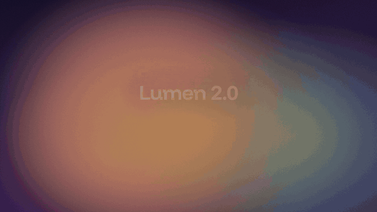
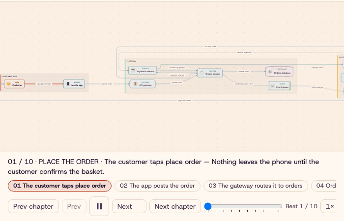
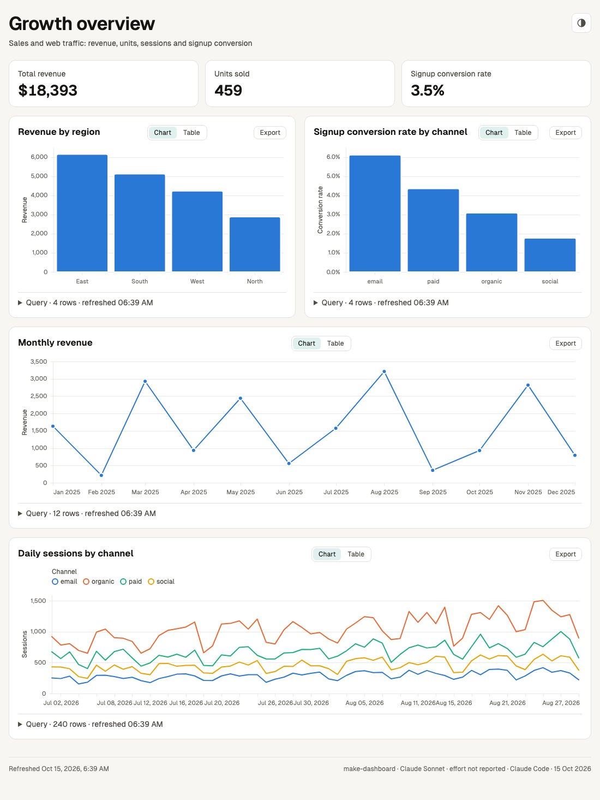
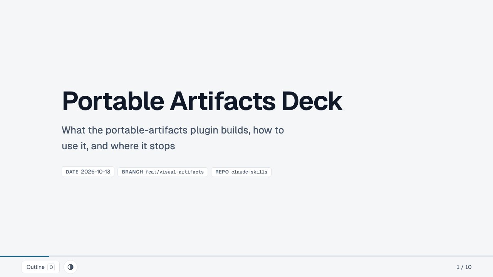

# claude-skills

[](https://github.com/abhijitbansal/claude-skills/actions/workflows/test.yml)
[](LICENSE)
[](#contributing)

**Run AI coding agents longer, cheaper, and across every tool you use.**

Skills, plugins, and tools for AI agents — one repo, usable from **Claude Code**,
**Codex**, **Copilot CLI**, and any **AGENTS.md-aware** agent. Highlights: a remote
**iOS build-and-screenshot loop** delivered to your phone, a **usage-limit
auto-resume** orchestrator that keeps overnight runs alive (`second-wind`),
**token-optimized CLI output** (`cartoon`), and Linear PM automation.

<p align="center">
  <a href="https://abhijitbansal.github.io/claude-skills/features/portable-artifacts.html#gallery"></a>
</p>

Made by an agent from this prompt with `/make-motion`: JSON in, MP4 out, offline.

```text
Make a 10-second launch announcement, 1920x1080: scene 1 the product name "Lumen 2.0" scales in with the tagline "Search that keeps up"; scene 2 a counter from 1 to 3 with the suffix "x faster" and the caption "Median query time vs 1.0"; scene 3 three feature labels (Offline index, Typo-tolerant, Private by default) appear one after another; end on "Available today".
```

Install it in Claude Code: after `/plugin marketplace add abhijitbansal/claude-skills`, run `/plugin install portable-artifacts@claude-skills`. These three came from the same plugin, each linked to its page:

<table>
  <tr>
    <td align="center" valign="top" colspan="2">
      <a href="https://abhijitbansal.github.io/claude-skills/features/showcase/portable-artifacts/gallery/delivery-diagram/dusk/index.html"></a><br>
      <sub><code>/make-diagram</code>: a diagram that plays its own story</sub>
    </td>
  </tr>
  <tr>
    <td align="center" valign="top" width="50%">
      <a href="https://abhijitbansal.github.io/claude-skills/features/showcase/portable-artifacts/growth-dashboard.html"></a><br>
      <sub><code>/make-dashboard</code>: two CSV files in, one offline dashboard out</sub>
    </td>
    <td align="center" valign="top" width="50%">
      <a href="https://abhijitbansal.github.io/claude-skills/features/showcase/portable-artifacts/gallery/explainer-deck/index.html"></a><br>
      <sub><code>/make-explainer</code>: a slide deck as one HTML file</sub>
    </td>
  </tr>
</table>

The dashboard came from this prompt:

```text
Build a "Growth overview" dashboard from data/sales.csv and data/web_traffic.csv: KPI tiles for total revenue, units sold and overall signup conversion rate; revenue by region; the monthly revenue trend; daily sessions by channel; and signup conversion rate by channel.
```

| Plugin | What you get |
| --- | --- |
| `ios-dev` | iOS feedback loop: simulator build + screenshot delivered to your phone, device builds, TestFlight/App Store release automation |
| `linear-pm` | Linear PM conventions + 6 `/linear-*` commands, including `/linear-pick` autonomous issue pickup |
| `core-workflow` | commit flow, skill contribution, image-parser + web-researcher agents, shellcheck-on-edit hook |
| `second-wind` | usage-limit-aware overnight orchestrator (`wind` CLI + skill wrapper) |
| `portable-artifacts` | `/make-dashboard` (data file → offline HTML dashboard, per-chart SQL), `/make-diagram` (prompt → offline HTML diagram with zoom and a presentation mode), `/make-explainer` (branch recap, concept page, plan the reviewer answers on the page, test checklist or slide deck as one offline HTML file), `/make-motion` (prompt → preview + MP4, silent unless you ask for sound, then music from your file or a locally synthesised voiceover; a viral mode for Reels, TikTok and Shorts, transitions, a scene camera, highlighted code, parallel rendering and one MP4 per data row) and `/make-scene` (your data as an explorable 3D city, forest, galaxy or terrain, or a diagram or chart lifted into 3D, with a camera tour); cross-host installer for Codex, Copilot, Gemini |
| `prompt-craft` | rough ask → deterministic spec (`/improve-prompt`, `/plan`), debug/refactor/review lenses, git-aware Stop hook + opt-in secret/format guardrails |
| `test-board` | band above the prompt: passed/failed/skipped after every test run, next to the previous run of the same suite in the same worktree |
| `session-compass` | what each session is building, where it stands and what it produced: compass band, `/compass` pane, `compass_status` tool |

**Feature guides:** [Second Wind](docs/features/second-wind.html) ·
[prompt-craft](docs/features/prompt-craft.html) ·
[portable-artifacts](docs/features/portable-artifacts.html) ·
[session mods](docs/features/mods.html) ·
[ios-dev](docs/features/ios-dev.html) ·
[linear-pm](docs/features/linear-pm.html) ·
[core-workflow](docs/features/core-workflow.html)

**Docs:** [Architecture](docs/architecture.md) ([visual](docs/architecture.html)) ·
[Skills & Tools Catalog](docs/skills-catalog.md) ([visual](docs/catalog.html)) ·
[Usage guide](USAGE.md)

## Installation

### Claude Code (recommended)

Inside any Claude Code session:

```
/plugin marketplace add abhijitbansal/claude-skills
/plugin install ios-dev@claude-skills
/plugin install linear-pm@claude-skills
/plugin install second-wind@claude-skills
/plugin install core-workflow@claude-skills
/plugin install prompt-craft@claude-skills
/plugin install portable-artifacts@claude-skills
/plugin install test-board@claude-skills
/plugin install session-compass@claude-skills
```

Install only what you need — each plugin is self-contained. Skills, slash commands,
agents, and hooks register automatically on install.

### Second Wind (standalone CLI)

No plugin required. Needs Python 3.9+, tmux, and the Claude Code CLI.
Includes an interactive `wind init` wizard and a live `wind dash` web dashboard.

```bash
curl -fsSL https://raw.githubusercontent.com/abhijitbansal/claude-skills/main/tools/second-wind/install.sh | sh

exec $SHELL
wind init     # interactive wizard: scans for repos, writes config
wind up       # one tmux session per repo + the detached auto-resume watcher
wind dash     # live localhost dashboard: status, pane tails, actions
```

`wind up` auto-spawns the watcher (detects the 5-hour limit, resumes after
reset) in its own detached tmux session — `--no-watch` skips it.

Full reference: [tools/second-wind/README.md](tools/second-wind/README.md) ·
[visual explainer](docs/second-wind/index.html)

### Cache Clock (Copilot CLI and VS Code Copilot chat)

A [cache-tax](https://github.com/karanb192/cache-tax)-style guard for GitHub Copilot:
shows when the prompt cache goes cold, what the next send costs cold vs warm, and asks
before a costly cold send goes out. Works in Copilot CLI, and in VS Code's Copilot chat
with a per-repo install (`install.sh --project`) and `"chat.canvases.enabled": true` in
VS Code settings.

```bash
curl -fsSL https://raw.githubusercontent.com/abhijitbansal/claude-skills/main/tools/cache-clock/install.sh | sh
curl -fsSL https://raw.githubusercontent.com/abhijitbansal/claude-skills/main/tools/cache-clock/install.sh | sh -s -- --project   # VS Code: run in each repo
node ~/.copilot/extensions/cache-clock/report.mjs --since 7d   # what cold sends already cost you
```

Then run `/cache-clock help` in Copilot.

Full reference: [tools/cache-clock/README.md](tools/cache-clock/README.md) ·
[guide](docs/features/cache-clock.html) ·
[visual explainer](docs/features/showcase/cache-clock/how-it-works.html) ·
[architecture diagram](docs/features/showcase/cache-clock/diagram/cache-clock-architecture.html) ·
[17-second video](docs/features/showcase/cache-clock/video.mp4)

### Other AI tools (Codex, Copilot CLI, Hermes, …)

The skills are plain SKILL.md directories — tool-agnostic. Clone, then run the adapter:

```bash
git clone https://github.com/abhijitbansal/claude-skills
cd claude-skills
adapters/install.sh codex      # symlink into ~/.codex/skills    (CODEX_SKILLS_DIR overrides)
adapters/install.sh copilot    # symlink into ~/.copilot/skills  (COPILOT_SKILLS_DIR overrides)
adapters/install.sh agents-md [path/to/AGENTS.md]   # managed skills-index block for AGENTS.md-aware tools
adapters/install.sh all
```

Idempotent — re-run after pulling updates; it prunes links for removed skills.

The `portable-artifacts` skills (`make-dashboard`, `make-diagram`, `make-explainer`, `make-motion`, `make-scene`) are Node packages: they also
need `npm ci` in each skill folder. Their own installer does that and covers Gemini CLI and
project-scoped installs too:
`node plugins/portable-artifacts/bin/install.mjs <claude|codex|copilot|gemini|agents> [--project .]`
— see [plugins/portable-artifacts/USAGE.md](plugins/portable-artifacts/USAGE.md).
With [`npx skills`](https://github.com/vercel-labs/skills): `npx skills add abhijitbansal/claude-skills --skill make-dashboard make-diagram make-explainer make-motion make-scene`. That does not resolve dependencies: `make-explainer` needs `make-diagram` and `make-dashboard` installed beside it (and `make-scene` for a `scene` section), and `make-scene` needs them to lift a diagram or a chart, so name them as shown.

### Cartoon (token-optimized CLI output)

[`cartoon`](https://github.com/abhijitbansal/cartoon) is a companion project — a
separate marketplace that wraps noisy CLI output (test runs, JSON CLIs) into a
compact format for ~70% fewer input tokens. The full machine seed below installs
it automatically; to add it on its own:

```text
# Claude Code
/plugin marketplace add abhijitbansal/cartoon
/plugin install cartoon@cartoon
```

```bash
# Other agents
npx skills add abhijitbansal/cartoon
```

The plugin's skill auto-installs the `cartoon` binary on first use, or install it
yourself: `uv tool install cartoon` (or `pipx install cartoon` /
`npm install -g cartoon-wrap` / `cargo install cartoon`).

## Setup (full machine seed)

For a machine you own: clones the repo, installs Claude Code, marketplaces, plugins
(including this repo's own, via a local marketplace), npx skills, dotfiles, PATH shims,
and the shared behavioral guidelines.

```bash
git clone https://github.com/abhijitbansal/claude-skills ~/projects/claude-skills
bash ~/projects/claude-skills/setup/setup.sh
```

Useful flags: `--dry-run`, `--only <step>`, `--skip-<step>`, `--merge-claude-md <path>`.
Steps: `preflight claude marketplaces plugins skills dotfiles guidelines local_plugins symlinks`.

The `guidelines` step evaluates the `CLAUDE.md` on the machine (`~/CLAUDE.md`) and on the
repo you run setup from, then additively merges in any missing behavioral-guideline section
from this repo's [`CLAUDE.md`](CLAUDE.md) (adapted from Andrej Karpathy's). It never clobbers
your own content — sections already present are skipped. Point it at any other file with
`--merge-claude-md <path>`.

Snapshot the machine's current state back into the repo:

```bash
bash setup/capture.sh && git diff
```

Note: `templates/` and `claude-setup.toml` are the owner's personal seed data — public
users can ignore them entirely; plugins never touch them.

## Layout

| Path | What |
| --- | --- |
| `.claude-plugin/` | marketplace manifest |
| `plugins/` | the eight plugins (skills, commands, agents, hooks) |
| `tools/` | standalone CLIs (second-wind) and the Copilot CLI extension (cache-clock) |
| `adapters/` | wire skills into non-Claude tools |
| `setup/`, `templates/`, `claude-setup.toml` | personal machine seed |
| `docs/` | architecture + catalog docs, design specs, implementation plans |
| `tests/` | bats + pytest suites |

## Development

```bash
bats tests/bats/                                  # shell suites (setup, adapters, skills, manifests)
uv tool run pytest tests/pytest -q                # TOML round-trip
uv tool run pytest tools/second-wind/tests -q     # wind CLI
(cd tools/cache-clock && node --test "test/*.test.mjs")   # cache-clock
shellcheck setup/*.sh adapters/*.sh
```

CI runs all of the above plus manifest validation on macOS and Ubuntu.
Design history lives in [docs/superpowers/specs/](docs/superpowers/specs/).

## Contributing

PRs welcome. From any repo on a seeded machine:

```bash
claude-skills-contribute --message "fix: ..."                      # capture current machine state
claude-skills-contribute --skill my-skill --plugin core-workflow   # scaffold a new skill
```

Or the ordinary way: fork, branch, `bats tests/bats/`, PR.

## License & support

MIT — see [LICENSE](LICENSE). If this repo saves you time, **star it** ⭐ — it helps
others find it. Issues and ideas: [GitHub issues](https://github.com/abhijitbansal/claude-skills/issues).
