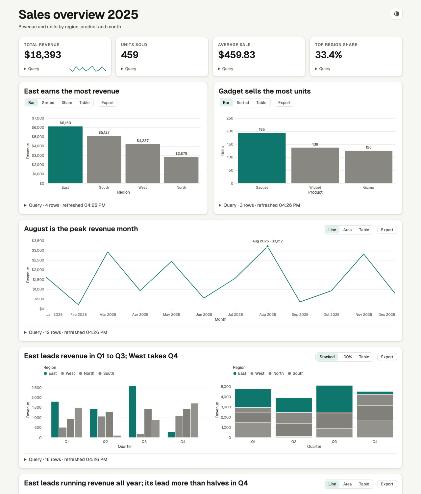
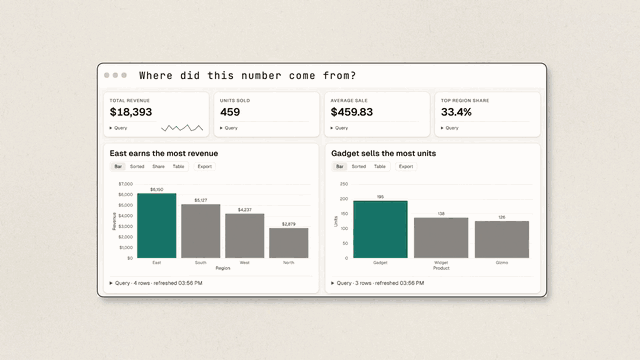

# portable-artifacts

**Dashboards, diagrams, explainer pages, 3D scenes and animated videos from a prompt — built locally, offline,
from open-source parts, by any coding agent.**

What changed in each release: [`CHANGELOG.md`](CHANGELOG.md).

Five agent skills that do what hosted "artifact" features do, without a cloud,
an account or a particular model:

| Skill | You say | You get |
|---|---|---|
| [`make-dashboard`](skills/make-dashboard/) | "Revenue by region and the monthly trend from `data/sales.csv`" | One self-contained `index.html`: KPI tiles + charts (11 kinds, alternate views, a sortable Table, PNG/SVG/CSV export, nine themes with `paper` by default). Every chart expands to show **its SQL, row count and refresh time**. Rerun one command to refresh, or `serve.mjs --watch` for live reload — no LLM involved. |
| [`make-diagram`](skills/make-diagram/) | "Draw the checkout request path from the browser to the orders DB" | One self-contained HTML diagram (architecture, flowchart, sequence or state) laid out with ELK: zoom, hover tracing, a story player (named chapters of beats with a travelling dot), an Explore panel, full screen and export (`build.mjs --format svg` writes one standalone SVG, no browser). The agent writes a small JSON topology; scripts do the rest. Nodes can carry general icons, software brand marks or `cloud:` icons (60 AWS and 4 Google Cloud, from a CC0 pack; the marks remain their owners' trademarks), and `icons.mjs import` adds the vendor's own icon download. |
| [`make-explainer`](skills/make-explainer/) | "Recap this branch with a manual test checklist" | One self-contained HTML page or slide deck made of typed sections (verdict, numbers, files changed, timeline, risks, comparisons, diffs, tick-and-remember checklists with steps and expected results (`build.mjs --md` also writes them as a markdown task list), slides, and a plan that explains before it asks, which the reviewer answers on the page and returns as a checked `plan-answers.json` or as the page saved with the answers inside), with make-diagram figures, make-dashboard charts, make-scene 3D scenes and make-motion clips embedded when asked. A script reads the git branch for the facts; the agent writes the prose; a linter rejects filler phrases and leftover placeholders before the page is built, and warns when emoji get dense. Most text sections can carry a plainer `simple` version; a Simple English toggle on the page switches between the two, and `check.mjs` measures both views. |
| [`make-motion`](skills/make-motion/) | "8-second clip: Q3 revenue up 18%, then a bar chart of Q1–Q3" | An MP4 drawn from a script of shots (`film.json`, version 2) by one engine, with a local preview page that has a scrubber (`make.mjs film.json --preview`). Seven looks set the style of the whole film: `desk`, `pop`, `cosmos`, `ledger`, `poster`, `keynote` and `marker`, a hand-drawn whiteboard. Sixteen kinds of shot: `statement`, `number`, `clipping`, `end`, `list`, `quote`, `compare`, `chart`, `media`, `screen`, `map`, `diagram`, `timeline`, `code`, `feed` and `free`. `pro` is a calm 16:9 explainer and `viral` is a fast 9:16 short for Reels, TikTok and Shorts. One command validates the film, reviews every shot in a browser, writes review sheets and renders the MP4. Silent unless you ask for sound: narration made on your machine (`say` on a shot), a synthesised music bed or your own music file, and synthesised cues are each added only when the prompt asks. Also `--outline` (the timed script with no browser), `--poster <seconds>` (one still), `--subtitles srt\|vtt` (writes a subtitle file), `--workers`, typed `vars` with `--batch rows.json` (one MP4 per row), `beats.mjs` (the beat grid of a music file), `cutout.mjs` (a person cut out of a photo or clip, MODNet on onnxruntime-node, installed on demand) and `storyboard.mjs` (a plan page to answer before a film over 20 s). "Slow shot 2" changes one field, not the whole film. Two renders of the same film and media give the same frames. It reads version 2 films only: a version 1 spec is refused with a pointer to `references/migrating.md`. |
| [`make-scene`](skills/make-scene/) | "Show our commits per week per folder as a 3D city, with a tour of the busiest weeks" | One self-contained 3D page drawn with a bundled three.js: your rows become a city, forest, galaxy or terrain, or a make-diagram diagram or one make-dashboard chart is lifted into 3D. Orbit, hover for exact values, an Explore list and a camera tour. The build recommends a world, then lists the alternatives with the one-line command to switch; switching costs no model tokens. `build.mjs --fragment` writes the scene as a block to paste into another page. |

[**See them in action**](https://abhijitbansal.github.io/claude-skills/features/portable-artifacts.html#films): the two showreel films (a 16:9 film and a 9:16 short) and one film for each of five make-motion looks, all made with make-motion 2 from one film file each, which you can open from the page. [Real outputs](https://abhijitbansal.github.io/claude-skills/features/portable-artifacts.html#showcase) has a dashboard an agent generated from one prompt, with the prompt and spec. The [gallery](https://abhijitbansal.github.io/claude-skills/features/portable-artifacts.html#gallery) has a Theme switch that shows every explainer, deck and diagram in `dusk`, `press` and `poster`; the make-motion 2 films do not change with it. Clips made with make-motion 1.x stay on the page as a labelled archive.

<p>
  
  
</p>

## How it works

The model writes **one small JSON spec**. Deterministic Node scripts do
everything else.

```
prompt ──▶ any agent ──▶ spec.json ──▶ validate ──▶ build / preview / render
                ▲                          │
                └── field-level errors ◀───┘   e.g. charts[0].query: "rev_by_regin"
                                                    not found; did you mean "rev_by_region"?
```

- **Small model job** — "write JSON that matches this schema" works on cheap
  hosted models: Claude Haiku's committed runs were all valid (dashboard 14/14,
  diagram 10/10, explainer 8/8, scene 10/10, motion 14/14, 14/14, 16/16 and 12/12 across
  its gates, all on make-motion 1), on releases before 1.2.0; the validator's
  did-you-mean errors drive the retry loop. Local models are less reliable: gemma4
  through Ollama built a dashboard 10/10 once (a rerun gave 7/10 and 6/10) but motion (make-motion 1) only 4/10 to 7/10 and explainer 0/8,
  so the eval refuses those two on a local model unless told to. See
  [`eval/results/INDEX.md`](eval/results/INDEX.md).
- **Targeted edits** — a change is one field in the spec, never regenerated
  code, so everything else stays exactly the same.
- **Reproducible** — the same spec always produces the same page or video. What varies is the provenance date in the footer, the day you build (set `SOURCE_DATE_EPOCH` to pin it), and a dashboard's refresh time. A hero image from `--image-api` comes from your service, so it can differ between builds.
- **Offline** — after a one-time install nothing touches the network except
  your own data sources. Specs that try (remote chart data, `url()` colours)
  are rejected, and the outputs carry a strict CSP. The one exception is
  opt-in: make-explainer's `--image-api` flag sends a page's title and
  subtitle to an image service you name (see [Themes and art](#themes-and-art)).
- **Stamped** — every page has a favicon, an icon theme toggle (Auto, Light,
  Dark; not on the make-motion preview) and a provenance line: the model,
  effort level and agent that wrote the spec, from the spec's `generatedBy`
  field or the `--model`, `--effort` and `--agent` build flags. A field the
  agent does not know reads "not reported"; nothing is guessed. The make-motion
  MP4 carries it in its `comment` tag, and the model in `artist` when it is reported
  (`make.mjs --no-provenance` or a root `"provenance": false` leaves both out;
  ffmpeg's own encoder tag stays).
- **Themed** — every page uses one of nine shared themes, and the
  theme sets the type. make-explainer pages and decks use
  `dusk` unless you or the prompt pick another; make-dashboard keeps `paper`
  and make-diagram `blueprint`. A make-motion film has a look, not a theme
  (`desk`, `pop`, `cosmos`, `ledger`, `poster`, `keynote` or `marker`).
  See [Themes and art](#themes-and-art).
- **Easy to read** — the explainer opens with a hero and TL;DR card, short
  section `label`s in its contents list and soft text caps that warn (never
  fail) when a title, paragraph or card runs long (`--strict` makes them fail).
- **Placed, and shown** — a built page lands in `$PA_OUTPUT_DIR`, else
  `<git root>/.scratch/<slug>.html` when the spec sits in a git repository, else
  `~/.agent/diagrams/` (make-diagram, make-explainer and make-scene; `--out` overrides it;
  make-dashboard writes `dist/` next to the spec and make-motion `out/`). The four page builders print
  the page as a `file://` URL alone on a line. `check.mjs --shots <dir>` (not make-motion's) and
  `shared/shot.mjs <page|folder> --widths 390,1280 --out <dir>` write PNGs of the page in
  light and dark; open them and look before you report.

## Themes and art

Nine themes live in the shared folder, each with its own light and dark
colours. Every skill accepts every theme by name (the spec's `theme` field or
`--theme <name>`); only the default differs.

| Theme | Display / body / mono | Look | Suits |
|---|---|---|---|
| `dusk` | Funnel Display / Host Grotesk / Commit Mono | aubergine to peach, coral and mint, film grain, tilted cards | anything; the default for make-explainer |
| `press` | Young Serif / Schibsted Grotesk / JetBrains Mono | bone paper, ink and vermilion, marginal numerals | dense docs, long reads, changelogs, branch recaps |
| `poster` | Big Shoulders Display / Familjen Grotesk / Martian Mono | near-black, acid lime and orange, condensed caps, halftone | launch decks, pitches, demos, energetic clips |
| `paper`, `blueprint`, `ink`, `editorial` | Geist and Geist Mono; `ink` has Bricolage Grotesque headings, `editorial` Newsreader headings and an Atkinson Hyperlegible body | the earlier looks | when you name one; `paper` is make-dashboard's default, `blueprint` make-diagram's |
| `mono` | JetBrains Mono for display, body and mono | terminal and engineering console: in dark mode a near-black page, one cyan accent and cool grey lines; a clean light mode; no art on a page, dot-matrix art on a deck's title and closing slides. Regular weight only (no bold face): headings, labels and numbers are drawn in regular weight, and any other bold text is synthesized by the browser | technical pages and plans |
| `brief` | Newsreader / Atkinson Hyperlegible / Geist Mono | executive: warm white page, deep burgundy accent, high contrast, calm; no art on a page, folder-tab art on a deck's title and closing slides | decision briefs and sign-off pages |

**How make-explainer picks a theme.** A theme you name wins
(`--theme poster`, or "use poster" in the prompt). Otherwise the agent picks
one from the prompt and tells you which and why in one line: `press` for dense
docs, long reads, changelogs and branch recaps, `poster` for launch decks,
pitches, demos and energetic clips, `dusk` for everything else. If the prompt
fits two themes equally, it asks you once, with a one-line feel for each of the
three; if it cannot ask, it uses `dusk`. The older themes are used only when
you name them. `mono` and `brief` are likewise used only when you name them; they are meant for the `plan` preset (see [USAGE.md](USAGE.md#4-explainers-with-make-explainer)), which defaults to `mono`.

**Art.** `dusk`, `press` and `poster` draw procedural SVG art seeded from the
title: blobs and orbs with grain in
`dusk`, halftone and contour lines in `press`, halftone grids and registration
marks in `poster`. The same seed always gives the same picture, and nothing is
fetched. It fills the explainer page hero and a deck's title and closing slides.
The other six themes draw their own art on a deck's title and closing slides only.

**Numbers stay on one line.** A number with its unit or percent sign (`1,204 ms`, `18%`, `$4.2M`) is kept on one line, in a different way per skill. make-explainer wraps each token in a no-wrap span when it renders (the spec text is not changed); its `validate.mjs` warns when a KPI value is longer than 12 characters, and its `check.mjs` fails on a token that wraps or a KPI value that overflows its tile. The one-line values in one `kpis` section are drawn at one size, the one that fits the longest; a wide or long value keeps its own. make-dashboard sets KPI values to no-wrap and sizes them to fit the tile; a value longer than 17 characters may wrap instead of spilling, and make-dashboard has no wrap check.
**Emoji** are allowed in explainer text. Validation warns, and never fails,
when a prose string has 3 or more emoji at more than 1 per 40 characters, or a
section title has more than 3.

**Optional hero image (make-explainer page only).** `build.mjs --image-api
<https-endpoint>` replaces the page hero's art with a picture from an image
service you run or pay for. It is off by default. With the flag:

- the page title and subtitle **leave your machine** and go to that host;
- the build needs your key in `PA_IMAGE_API_KEY`;
- each build is one request, which **your service may bill**;
- it works on a `dusk`, `press` or `poster` page; a deck or any other theme is
  refused before anything is sent.

The endpoint contract is in
[`make-explainer/references/schema.md`](skills/make-explainer/references/schema.md#hero-image-from-an-image-api).

## Install

### Claude Code

```bash
/plugin marketplace add abhijitbansal/claude-skills
/plugin install portable-artifacts@claude-skills
```

Then ask for a dashboard, a diagram, an explainer, a 3D scene or a video, or call the skill directly:
`/make-dashboard …`, `/make-diagram …`, `/make-explainer …`, `/make-motion …` or `/make-scene …`. On first use the agent runs the
skill's doctor and, once you agree, installs the dependencies (`npm ci --ignore-scripts` inside the skill folder; `npm ci --ignore-scripts --omit=dev` for make-dashboard, make-diagram, make-explainer and make-scene).

### Any agent, with `npx skills`

[`skills`](https://github.com/vercel-labs/skills) installs the five skill
folders into whichever agents you pick (Claude Code, Codex, Copilot,
Cursor, Gemini CLI, and others):

```bash
npx skills add abhijitbansal/claude-skills --skill make-dashboard make-diagram make-explainer make-motion make-scene
npx skills add abhijitbansal/claude-skills --skill make-dashboard make-diagram make-explainer make-motion make-scene -a claude-code codex github-copilot -y
```

It copies the folders but doesn't install their dependencies, so on first use
the agent runs the skill's doctor and, once you agree, `npm ci --ignore-scripts` inside the skill
folder (the SKILL.md tells it to; make-dashboard, make-diagram, make-explainer and make-scene
need only `npm ci --ignore-scripts --omit=dev`).

**`make-explainer` needs `make-diagram` and `make-dashboard` next to it** to
draw diagrams, charts and card icons (and `make-motion` to render a motion film, version 2;
an existing `.mp4` needs nothing). `make-scene` lists both as requirements (the installer pulls them in), but uses `make-diagram` only to lift a
diagram into 3D and `make-dashboard` only to lift a chart; a plain world needs neither. `make-explainer` needs `make-scene` only for a `scene` section. `npx skills add` does not resolve
dependencies, so name them:

```bash
npx skills add abhijitbansal/claude-skills --skill make-explainer make-diagram make-dashboard
```

If you forget, the first section that needs a missing skill fails validation
with that exact command. `bin/install.mjs` (below) does resolve them: it reads
`portableArtifacts.requires` from the skill's `package.json` and installs
`make-diagram` and `make-dashboard` before `make-explainer` or `make-scene`, whether or not you
named them. `make-motion` is optional and is installed only if you ask for it.

### Codex, GitHub Copilot, Gemini CLI (or Claude Code without the marketplace)

Each host reads skill folders from its own directory, and the skill itself is
the slash command. The installer copies all five skills to the right place and
installs their dependencies:

```bash
git clone https://github.com/abhijitbansal/claude-skills
node claude-skills/plugins/portable-artifacts/bin/install.mjs codex             # ~/.agents/skills
node claude-skills/plugins/portable-artifacts/bin/install.mjs copilot --project .  # ./.github/skills
```

| Host | `install.mjs` host | User dir | Project dir (`--project <dir>`) | Invoke |
|---|---|---|---|---|
| Claude Code | `claude` | `~/.claude/skills` | `.claude/skills` | `/make-dashboard …` |
| Codex CLI | `codex` | `~/.agents/skills` | `.agents/skills` | `$make-dashboard …` (or `/skills`) |
| GitHub Copilot (CLI + VS Code) | `copilot` | `~/.copilot/skills` | `.github/skills` | `/make-dashboard …` |
| Gemini CLI | `gemini` | `~/.gemini/skills` + `~/.gemini/commands/*.toml` | `.gemini/…` | `/make-dashboard …` |
| Anything reading `.agents/skills` | `agents` | `~/.agents/skills` | `.agents/skills` | host-specific |

Flags: `--skills make-motion` (just one), `--link` (symlink to this checkout
so `git pull` updates it), `--force` (replace an existing install),
`--no-deps` (skip `npm ci --ignore-scripts`). Asking for `--skills make-explainer` installs its
required skills too.

**Any other agent** that can read files and run shell commands: copy a skill
folder into your project **together with its `shared/` folder** (it sits inside
the skill folder, so copy the folder whole), run `npm ci --ignore-scripts` inside it
(`npm ci --ignore-scripts --omit=dev` for make-dashboard, make-diagram, make-explainer and make-scene; copy
`make-diagram` and `make-dashboard` too if you use make-explainer), and add one line to your
`AGENTS.md` (or `.github/copilot-instructions.md`):

```markdown
To build a dashboard, a diagram, an explainer page, a 3D scene or an animated video, read and follow skills/make-dashboard/SKILL.md, skills/make-diagram/SKILL.md, skills/make-explainer/SKILL.md, skills/make-motion/SKILL.md or skills/make-scene/SKILL.md.
```

### Requirements

Not sure what is missing? Run `node <skill-dir>/scripts/doctor.mjs --json` (it
needs only Node, so it works before `npm ci --ignore-scripts`). It lists each missing item with
its size and the fix for your OS; add `--for` with a spec `.json` (every skill;
make-explainer and make-scene add sister skills from it), `check` (make-dashboard, make-diagram, make-explainer and make-scene: the check browser),
`voiceover` or `cutout` (make-motion), and `--fix <ids>`
to install the ones that need no `sudo` (ids are resolved against the same `--for`;
`dev_deps` and `chromium` are required for `check`, and `motion_chromium` is
make-explainer's browser for a motion section). Agents run it first and ask once before installing
anything.

**Stale plugin copies.** The Claude plugin keeps every installed version in `~/.claude/plugins/cache/`, and `~/.claude/plugins/installed_plugins.json` says which one is current. A build or render started from an older folder prints one line on stderr and carries on:

```
warning: this script runs from <old copy>, not the installed copy <installed copy>; run npm ci --ignore-scripts in <installed copy>/skills/<skill> (or node <installed copy>/skills/<skill>/scripts/doctor.mjs --fix node_modules), then use that copy
```

Fix it by running `npm ci --ignore-scripts` in the installed skill folder (or its `doctor.mjs --fix node_modules`) and using that folder's scripts. A repo checkout, an `npx skills add` install, or a missing `installed_plugins.json` draws no warning.

| | make-dashboard | make-diagram | make-explainer | make-motion | make-scene |
|---|---|---|---|---|---|
| Node.js ≥ 20 | ✓ | ✓ | ✓ | ✓ | ✓ |
| `npm ci --ignore-scripts` in the skill folder (once; `--omit=dev` is enough for make-dashboard, make-diagram, make-explainer and make-scene) | ✓ | ✓ | ✓ | ✓ | ✓ |
| Installed size (`node_modules` after that install; Chromium and on-demand installs are extra) | ≈150 MB | ≈11 MB | ≈3 MB | ≈57 MB | ≈3 MB |
| Other skills beside it | — | — | make-diagram and make-dashboard (required for diagram and chart sections and for card icons); make-motion only to render a motion spec | — | make-diagram to lift a diagram, make-dashboard to lift a chart; a plain world needs none |
| `git` on `PATH` | — | — | only for `gather.mjs` | — | — |
| Chromium for frame capture (once, ≈150 MB) | optional: only `check.mjs` (a full `npm ci --ignore-scripts` plus a Chromium, as for make-diagram); the build needs no browser | optional: only `check.mjs` (needs a full `npm ci --ignore-scripts`, not `--omit=dev`, plus `npx playwright install chromium` in the skill folder); build needs no browser, and `check.mjs` skips cleanly without one | none to build; only a motion section that renders a spec needs make-motion's Chromium | `npx playwright install chromium` inside the skill folder (Linux: `--with-deps`; falls back to installed Google Chrome) | optional: only `check.mjs` (needs a full `npm ci --ignore-scripts` plus a Chromium, as for make-diagram); build needs no browser, and `check.mjs` skips cleanly without one |
| ffmpeg on `PATH` | — | — | only to render a motion film | `brew install ffmpeg` / `winget install Gyan.FFmpeg` / `sudo apt-get install ffmpeg`, or set `FFMPEG_PATH` (≥ 5.1 for the limiter stage of the audio mastering; the doctor says so when yours is older) | — |
| onnxruntime-node (cutouts only, on demand) | — | — | — | `npm ci --ignore-scripts --prefix <skill-dir>/optional/cutout` (≈300 MB, from that folder's lockfile; install scripts are skipped because onnxruntime-node's downloads GPU libraries without a hash) plus a one-time 25 MB MODNet model download (pinned commit, SHA-256 checked); the agent asks first; `npm ci --ignore-scripts` in the skill folder leaves it alone | — |
| onnxruntime-node and phonemizer (voiceover only, on demand) | — | — | — | `npm ci --ignore-scripts --prefix <skill-dir>/optional/voice` (≈227 MB on macOS, from that folder's lockfile, install scripts skipped) plus a one-time 93 MB Kokoro model download (one pinned commit, each file SHA-256 checked); the agent asks first; `npm ci --ignore-scripts` in the skill folder leaves it alone. An install made before make-motion 2 also holds `kokoro-js` and still works | — |

The installed sizes are the on-disk size of each skill's production dependency tree, measured on macOS in a dev checkout
(not a fresh install from the plugin cache): `npm ls --omit=dev --all --parseable` in the skill folder, then the size of every
package it lists. make-motion's figure is its whole tree, because Playwright is a regular dependency there. The doctor shows
the same figures at its consent prompt. To check one on your machine, run `npm ci --ignore-scripts --omit=dev` in the skill folder and then `du -sh node_modules`.

Re-measured on 2026-11-18 on macOS from a copy holding only each skill's `package.json` and `package-lock.json`
(`npm ci --ignore-scripts --omit=dev`, make-motion without `--omit=dev`), then `du -sk node_modules`: make-dashboard 146084 KiB,
make-diagram 10728, make-explainer 2844, make-motion 55304, make-scene 2844 (the `npm ls` sum above gave 146036, 10724, 2840, 55276
and 2840). In MB (KiB x 1024 / 1,000,000) every figure in the table holds; make-motion's 56.6 MB is the ≈57 MB the table and the doctor
give. The voice package's ≈227 MB is `du -sk` over the 23 packages of `optional/voice/package-lock.json`
in an existing install (221676 KiB), not a fresh install; that install also holds the older `kokoro-js` tree, which is why the
whole folder is larger.

Install make-motion's tools per OS (run the Chromium download inside the
make-motion skill folder, so it matches the Playwright version `npm ci --ignore-scripts` installed):

| | macOS (Homebrew) | Windows (PowerShell) | Linux (Debian/Ubuntu) |
|---|---|---|---|
| Node.js ≥ 20 | `brew install node` | `winget install OpenJS.NodeJS.LTS` | nodejs.org or a version manager (distro packages are often older) |
| ffmpeg | `brew install ffmpeg` | `winget install Gyan.FFmpeg` (or `choco install ffmpeg` / `scoop install ffmpeg`) | `sudo apt-get install ffmpeg` |
| Chromium | `npx playwright install chromium` | `npx playwright install chromium` | `npx playwright install --with-deps chromium` (adds the system libraries; asks for sudo) |

On Windows, open a new terminal after `winget` so `node` and `ffmpeg` are on `PATH`. If
PowerShell refuses `npx.ps1` (scripts disabled), run `npx.cmd playwright install chromium`.

## Director and operator

Each `SKILL.md` has a `## Director and operator` section. The agent you talk to is the director: it runs the intake, writes the spec, views what was built and decides every `creative` finding. It may hand the one build command, `make.mjs <spec> --json`, to a small `artifact-builder` operator agent on a cheap model, which fixes only `mechanical` findings and returns the report; the director takes over if the same finding survives two attempts, and runs the command itself when no such agent is listed. No `SKILL.md` pins a model any more. The installer writes the agent file for each host (Claude Code ships it in the plugin; Copilot and Codex get a file at user or project level). Per host:

| Host | Operator | Status |
|---|---|---|
| Claude Code | `agents/artifact-builder.md` in the plugin, `model: haiku`: the one deterministic pin | Run live, 2026-11-18 (below) |
| Copilot CLI, Codex | installed agent files; the model decides whether to delegate | Install-tested, not run live |
| Any other host, or no agent listed | none: the director runs `make.mjs` itself | The fallback in every `SKILL.md` |

```bash
node plugins/portable-artifacts/bin/install.mjs claude
node plugins/portable-artifacts/bin/install.mjs claude --agents-only
```

The first line installs the skills and the agent; the second writes only the agent, for skills you installed another way (use `copilot`, `codex` or `agents` in place of `claude` for those hosts). Installed with `npx skills add` (skill folders only, no `bin/`)? Each skill carries its own writer: when `~/.copilot` or `~/.codex` exists, the skill's doctor reports the missing agent file as an optional item and, once you agree, `node <skill-dir>/scripts/doctor.mjs --fix builder_agent` writes it at user level (an existing file is kept). A host may need a new session before it lists the agent.

**Measured on Claude Code, 2026-11-18** (Claude Code 2.1.327, make-motion 2, the 10 motion prompts, one run each, `node plugins/portable-artifacts/eval/run-eval.mjs --skill motion --host claude-director --only <the ten ids> --budget 2`, setting sources `project` only by flag; figures read from the session stream by `eval/session.mjs`): 10 of 10 valid, 10 of 10 delegated to `artifact-builder`, operator model `claude-haiku-5-5` and director model `claude-opus-5-5` in all ten, first build valid in 9 of 10, total cost $4.66 at list price. One sample per prompt; the films were not judged by a person, and no other skill or host was run. Record: [`summary-director-operator-2026-11-18.md`](eval/results/summary-director-operator-2026-11-18.md).

**Measured on Copilot CLI, 2026-10-21, with the previous agent text, which wrote the spec** (the earlier "Cheaper model" scheme, make-motion 1): all 10 motion prompts and 9 runs across the other four skills built a valid page on `claude-haiku-5.5`, and Copilot's own logs confirm the model. Codex files were written from the Codex docs and not run live. Full table, per-host files and the cost statement: [USAGE.md](USAGE.md#director-and-operator); results: [`summary-routing-2026-10-21.md`](eval/results/summary-routing-2026-10-21.md).

## Usage

Full walkthroughs, spec reference and troubleshooting: **[USAGE.md](USAGE.md)**.
Each skill folder also has its own README.

## Security model

- **Dashboards run model-written SQL.** Each query must parse (DuckDB's own
  parser) as a single SELECT, and an allowlist over its syntax tree lets it read
  only the declared sources and its own CTEs (table functions: `range`,
  `generate_series`, `unnest`; no `query()`, `read_*`, `duckdb_*`, system
  catalogs or `sqlite_*`/`postgres_*`/`mysql_*` bridges). It runs wrapped in a
  row limit and a timeout, against a DuckDB connection locked to the exact
  declared files (`allowed_paths`, external access off, configuration locked).
  Sources must live under the spec's folder unless you pass `--allow-outside`.
  Attached DuckDB files with views or macros are refused. For Postgres and
  MySQL, `READ_ONLY` only limits DuckDB: **use a read-only database role**.
  Credentials come only from environment variables and are scrubbed from
  errors and result cells (defence in depth: the SQL allowlist is the control).
- **Built pages embed the query results.** Publishing `index.html` publishes
  the data.
- **No network from specs.** Chart `url`/`data`/`usermeta` keys are rejected at
  any depth; a make-motion film can't name a remote URL or a file outside its folder; pages run under a CSP without
  `unsafe-eval`; the renderer aborts any non-local request; local servers bind
  `127.0.0.1` and check the `Host` header.

## Tested hosts

Every figure here predates 1.2.0, every motion figure was measured on make-motion 1, and the one later committed summary is the 2026-11-18 Claude Code run of the director and operator scheme (make-motion 2, under "Director and operator" above) (which release each summary covers: [`eval/results/INDEX.md`](eval/results/INDEX.md)). Tested live: **Claude Code**, and **GitHub Copilot CLI 1.0.98** (one non-interactive run per skill on 2026-10-15, plus reruns of the doctor install path; the browser check and the ask-first consent prompt were not exercised there). A second Copilot CLI 1.0.98 run on 2026-10-21 drove the `artifact-builder` agent under the earlier scheme, where the cheap model wrote the spec: motion 10/10 valid builds, and 9/9 across dashboard, diagram, explainer and scene, with Copilot's logs showing `claude-haiku-5.5` for all 19 runs; one skill hand-off trial, where the sub-agent hit a permission denial and the main agent finished the job ([`summary-routing-2026-10-21.md`](eval/results/summary-routing-2026-10-21.md)). An earlier live eval on 2026-10-10 ran **Codex CLI 0.145.0**: dashboard 10/10, motion 5/10 under today's scorer (the summary counted six valid, one of them an edit that left the seed untouched; four more prompts were stopped by the account's usage limit, and the five that ran all built a page) ([`summary-full-2026-10-10.md`](eval/results/summary-full-2026-10-10.md)). A local gemma4 through Ollama: dashboard 10/10 on 2026-10-10, not reproduced on 2026-10-12 (7/10 and 6/10 on the same prompts, [`summary-dashboard-v2-2026-10-12.md`](eval/results/summary-dashboard-v2-2026-10-12.md)), motion 4/10 to 7/10, explainer 0/8. **Gemini CLI**: install paths verified against its documentation, not run live. **make-scene**: 10/10 valid builds on the first run (Claude Haiku in Claude Code, median 1.5 validate runs, median 40 s) ([`summary-scene-2026-10-19.md`](eval/results/summary-scene-2026-10-19.md)).

Details:
[`eval/results/summary-portability-copilot-2026-10-15.md`](eval/results/summary-portability-copilot-2026-10-15.md)
and [`eval/results/summary-install-targets-2026-10-15.md`](eval/results/summary-install-targets-2026-10-15.md).

## Cross-host eval

[`eval/`](eval/) runs a fixed set of prompts per skill (the default set has 8 to 14, and there are further sets: explainer features, dashboard chart kinds, a cloud diagram) through `claude` (with or
without `--model`), `codex`, `codex --oss` (Ollama), `gemini` and `copilot`. The full run on
2026-10-10 covered dashboard and motion (make-motion 1) on claude, codex, copilot and codex --oss;
Gemini was skipped. The motion set is now eleven version 2 prompts, and no run of it has a committed summary. The harness scores spec
written / valid / validate calls and whether the first one passed / build or render ok / the browser
check where the skill has one / whether the spec used the feature the prompt asked for / changed paths on edit
prompts (a rewrite of the seed is flagged). Results summaries live in `eval/results/summary-*.md`, and
[`eval/results/INDEX.md`](eval/results/INDEX.md) says which release each covers and what is stale.

## Licences

Everything this plugin depends on is open source:

| Component | Licence |
|---|---|
| [DuckDB](https://duckdb.org) (`@duckdb/node-api`) | MIT |
| [Vega](https://vega.github.io), Vega-Lite, vega-embed, vega-interpreter, vega-util (make-dashboard's charts) | BSD-3-Clause |
| [three.js](https://threejs.org) 0.186.1 (bundled into make-scene's `template/vendor/scene-runtime.min.js`, with OrbitControls; its notice is in `skills/make-scene/THIRD_PARTY_NOTICES.md`) | MIT |
| [shiki](https://shiki.style) 4.5.0 (`shiki`, `@shikijs/core`, `@shikijs/primitive`, `@shikijs/types`, `@shikijs/engine-javascript`, `@shikijs/langs`, `@shikijs/vscode-textmate`) and what it imports (make-motion 2 colours code with it in Node, never in the page: `oniguruma-to-es`, `oniguruma-parser`, `regex`, `regex-recursion`, `regex-utilities`, `hast-util-to-html`, `hast-util-whitespace`, `property-information`, `stringify-entities`, `ccount`, `character-entities-html4`, `character-entities-legacy`, `comma-separated-tokens`, `html-void-elements`, `space-separated-tokens`, `zwitch`) | MIT |
| [world-atlas](https://github.com/topojson/world-atlas) 2.0.2 (Natural Earth TopoJSON; make-motion 2's world maps, read in Node from `countries-110m.json`) | ISC |
| [us-atlas](https://github.com/topojson/us-atlas) 3.0.1 (US Census TopoJSON; make-motion 2's US maps, read in Node from `states-10m.json`) | ISC |
| [d3-geo](https://github.com/d3/d3-geo) 3.1.1 (`d3-geo`, with `d3-array` and `internmap`; make-motion 2 projects its maps with it in Node, never in the page) | ISC |
| [topojson-client](https://github.com/topojson/topojson-client) 3.1.0 (`topojson-client`; make-motion 2 reads the atlases with it in Node, never in the page) | ISC |
| `commander` 2.20.3 (topojson-client's command-line tools, installed, never run or served) | MIT |
| shiki's other dependencies, installed by npm but never served to the page (`@shikijs/themes`, `@shikijs/engine-oniguruma`, `mdast-util-to-hast`, `micromark-util-*`, `unist-util-*`, `vfile`, `vfile-message`, `devlop`, `dequal`, `trim-lines`, `@types/hast`, `@types/mdast`, `@types/unist`) | MIT |
| `@ungap/structured-clone` (a shiki dependency, installed, never served) | ISC |
| [Playwright](https://playwright.dev) | Apache-2.0 |
| [Ajv](https://ajv.js.org) | MIT |
| [ELK](https://github.com/kieler/elkjs) (`elkjs`) | EPL-2.0 |
| [Lucide](https://lucide.dev) icons (make-diagram's icon catalog) | ISC |
| [Feather](https://feathericons.com) (the project some Lucide icons derive from; its notice is in `skills/make-diagram/THIRD_PARTY_NOTICES.md`) | MIT |
| [gl-transitions](https://github.com/gl-transitions/gl-transitions) (ten fragment shaders ported into make-motion version 2's shader cuts, `engine/cuts/shaders`; the list, authors, pinned commit and licence texts are in `skills/make-motion/THIRD_PARTY_NOTICES.md`) | MIT, BSD-3-Clause |
| [Simple Icons](https://simpleicons.org) brand marks | CC0-1.0 |
| [SVG Logos](https://github.com/gilbarbara/logos) (`@iconify-json/logos` 1.2.19; make-diagram's 60 AWS and 4 Google Cloud `cloud:` icons). The marks remain the trademarks of Amazon Web Services and Google; CC0 covers the drawings, not the trademarks | CC0-1.0 |
| [Caveat](https://github.com/googlefonts/caveat), Fraunces, Archivo, Nunito and Geist (variable Latin files from `@fontsource-variable/*` 5.3.0, in `skills/make-motion/engine/fonts/`; the `marker` look writes in Caveat; sources and SHA-256 are in `engine/fonts/SOURCES.md`) | OFL-1.1 |
| Funnel Display, Host Grotesk, Commit Mono, Young Serif, Schibsted Grotesk, JetBrains Mono, Big Shoulders Display, Familjen Grotesk, Martian Mono, Geist, Geist Mono, Newsreader, Bricolage Grotesque, Atkinson Hyperlegible (latin subsets, via Fontsource) | OFL-1.1 |
| ffmpeg (system binary, not vendored) | LGPL/GPL |
| [Kokoro](https://github.com/hexgrad/kokoro) TTS (make-motion 2 no longer installs `kokoro-js`; `normalize` and `toPhonemes` in `scripts/v2/voice/phonemes.mjs` are transcribed from kokoro-js 1.2.1) | Apache-2.0 |
| [MODNet](https://github.com/ZHKKKe/MODNet) portrait matting weights (about 25 MB, downloaded on first use of `cutout.mjs` from Hugging Face `Xenova/modnet`, pinned to one commit and a SHA-256) | Apache-2.0 |
| Kokoro-82M ONNX timestamped weights and the `af_heart` voice file (about 93 MB, downloaded on first voiceover from Hugging Face onnx-community/Kokoro-82M-v1.0-ONNX-timestamped, pinned to one commit and a SHA-256 per file) | Apache-2.0 |
| [eSpeak NG](https://github.com/espeak-ng/espeak-ng) through [`phonemizer`](https://www.npmjs.com/package/phonemizer) 1.2.1 (turns narration text into phonemes for the version 2 voiceover; installed on demand into `optional/voice` from its lockfile, never redistributed with this plugin) | GPL-3.0-or-later for eSpeak NG, by our reading of upstream; `phonemizer` itself declares Apache-2.0 |
| [onnxruntime-node](https://github.com/microsoft/onnxruntime) 1.31.1 (installed on demand into `optional/cutout` from its lockfile, runs MODNet) | MIT |

Not used, by design: Remotion and GSAP (free to use, but not under OSI
licences).
