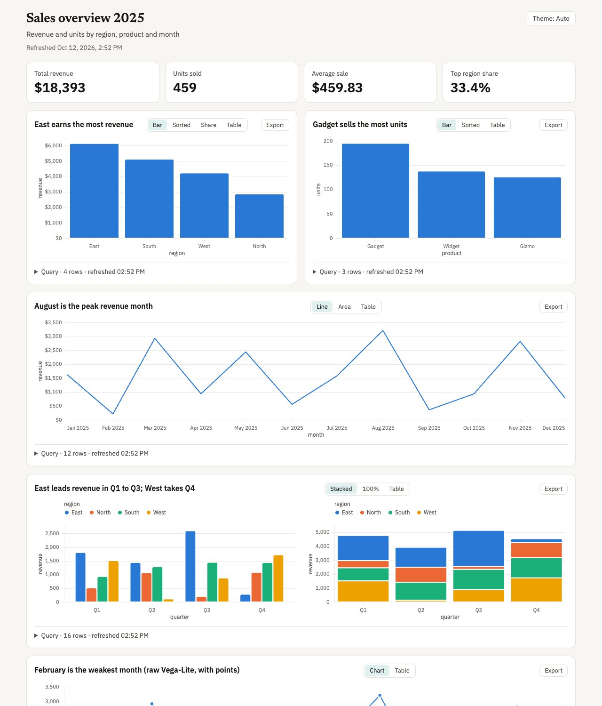

# portable-artifacts

**Dashboards, diagrams, explainer pages, 3D scenes and animated videos from a prompt — built locally, offline,
from open-source parts, by any coding agent.**

What changed in each release: [`CHANGELOG.md`](CHANGELOG.md).

Five agent skills that do what hosted "artifact" features do, without a cloud,
an account or a particular model:

| Skill | You say | You get |
|---|---|---|
| [`make-dashboard`](skills/make-dashboard/) | "Revenue by region and the monthly trend from `data/sales.csv`" | One self-contained `index.html`: KPI tiles + charts (11 kinds, alternate views, a sortable Table, PNG/SVG/CSV export, nine themes with `paper` by default). Every chart expands to show **its SQL, row count and refresh time**. Rerun one command to refresh, or `serve.mjs --watch` for live reload — no LLM involved. |
| [`make-diagram`](skills/make-diagram/) | "Draw the checkout request path from the browser to the orders DB" | One self-contained HTML diagram (architecture, flowchart, sequence or state) laid out with ELK: zoom, hover tracing, a story player (named chapters of beats with a travelling dot), an Explore panel, full screen and export. The agent writes a small JSON topology; scripts do the rest. |
| [`make-explainer`](skills/make-explainer/) | "Recap this branch with a manual test checklist" | One self-contained HTML page or slide deck made of typed sections (verdict, numbers, files changed, timeline, risks, comparisons, tick-and-remember checklists, slides, and a plan that explains before it asks, which the reviewer answers on the page and returns as a checked `plan-answers.json` or as the page saved with the answers inside), with make-diagram figures, make-dashboard charts, make-scene 3D scenes and make-motion clips embedded when asked. A script reads the git branch for the facts; the agent writes the prose; a linter rejects filler phrases and leftover placeholders before the page is built, and warns when emoji get dense. |
| [`make-motion`](skills/make-motion/) | "8-second clip: Q3 revenue up 18%, then a bar chart of Q1–Q3" | A live preview with a scrubber and a deterministic **1080p MP4**. Silent unless you ask for sound (or pick viral mode, which places cues on cuts and entrances): `audio` tracks (music, voiceover, SFX) and `cues` (pop, click, whoosh, chime, impact, riser, swoosh, typing, drop, ding, synthesised locally in layers; typing clicks follow a typed-out line; or twelve recorded clicks and hits as `kenney:<name>`, about 261 KB bundled) are added only when the prompt asks, and narration is synthesised locally with Kokoro. Theme colour tokens, elevated cards, round-cap and arrow lines, polished chart defaults, scene crossfade and six more transitions (push, slide, wipe, zoom, blur, iris), a scene camera (keyframed zoom, pan and roll, seeded shake), an opt-in vignette and film grain, typed-out text, highlighted code (fourteen languages, offline, typed out or as a diff), groups that move several elements as one, fifteen blocks (title card, lower third, KPI counter, step flow, quote card, checklist, logo outro, closing call to action, soft call to action, five-beat story, numbered list, before and after swipe, code typing, code diff, terminal run) written as a few params each, real video clips (trimmed, decoded once into a frame cache so every frame is exact, their sound in the mix), captions from an SRT, VTT or Whisper file or the voiceover in six styles (plain, pill, karaoke, kinetic, boxed, typewriter), and a viral mode for Reels, TikTok and Shorts (9:16, a platform safe zone, a hook on screen from frame 0, auto-placed cues, a −14 LUFS target and warnings on pacing, the hook and captions). `check.mjs` also audits contrast, reading time, dead stretches (`"hold": true` opts an element out) and small text. `render.mjs --workers 4` captures frames in parallel for the same MP4, and `--quality draft` renders half size for a quick look. "Slow scene 2" changes one field, not the whole video. |
| [`make-scene`](skills/make-scene/) | "Show our commits per week per folder as a 3D city, with a tour of the busiest weeks" | One self-contained 3D page drawn with a bundled three.js: your rows become a city, forest, galaxy or terrain, or a make-diagram diagram or one make-dashboard chart is lifted into 3D. Orbit, hover for exact values, an Explore list and a camera tour. The build recommends a world, then lists the alternatives with the one-line command to switch; switching costs no model tokens. |

[**See them in action**](https://abhijitbansal.github.io/claude-skills/features/portable-artifacts.html#showcase): a real dashboard and video an agent generated from one prompt each, with the prompts and specs. The [gallery](https://abhijitbansal.github.io/claude-skills/features/portable-artifacts.html#gallery) has a Theme switch that shows every explainer, deck, diagram and clip in `dusk`, `press` and `poster`.

<p>
  
  
</p>

## How it works

The model writes **one small JSON spec**. Deterministic Node scripts do
everything else.

```
prompt ──▶ any agent ──▶ spec.json ──▶ validate ──▶ build / preview / render
                ▲                          │
                └── field-level errors ◀───┘   e.g. charts[0].query: "rev_by_regin"
                                                    not found; did you mean "rev_by_region"?
```

- **Small model job** — "write JSON that matches this schema" works on weak
  and local models too; the validator's did-you-mean errors drive the retry
  loop.
- **Targeted edits** — a change is one field in the spec, never regenerated
  code, so everything else stays exactly the same.
- **Reproducible** — the same spec always produces the same page or video. What varies is the provenance date in the footer, the day you build (set `SOURCE_DATE_EPOCH` to pin it), and a dashboard's refresh time. A hero image from `--image-api` comes from your service, so it can differ between builds.
- **Offline** — after a one-time install nothing touches the network except
  your own data sources. Specs that try (remote chart data, `url()` colours)
  are rejected, and the outputs carry a strict CSP. The one exception is
  opt-in: make-explainer's `--image-api` flag sends a page's title and
  subtitle to an image service you name (see [Themes and art](#themes-and-art)).
- **Stamped** — every page has a favicon, an icon theme toggle (Auto, Light,
  Dark; not on the make-motion preview) and a provenance line: the model,
  effort level and agent that wrote the spec, from the spec's `generatedBy`
  field or the `--model`, `--effort` and `--agent` build flags. A field the
  agent does not know reads "not reported"; nothing is guessed. The make-motion
  MP4 carries it in its `comment` tag, and the model in `artist` when it is reported.
- **Themed** — every page and video uses one of nine shared themes, and the
  theme sets the type. make-explainer pages and decks and make-motion clips use
  `dusk` unless you or the prompt pick another; make-dashboard keeps `paper`
  and make-diagram `blueprint`. See [Themes and art](#themes-and-art).
- **Easy to read** — the explainer opens with a hero and TL;DR card, short
  section `label`s in its contents list and soft text caps that warn (never
  fail) when a title, paragraph or card runs long.

## Themes and art

Nine themes live in the shared folder, each with its own light and dark
colours. Every skill accepts every theme by name (the spec's `theme` field or
`--theme <name>`); only the default differs.

| Theme | Display / body / mono | Look | Suits |
|---|---|---|---|
| `dusk` | Funnel Display / Host Grotesk / Commit Mono | aubergine to peach, coral and mint, film grain, tilted cards | anything; the default for make-explainer and make-motion |
| `press` | Young Serif / Schibsted Grotesk / JetBrains Mono | bone paper, ink and vermilion, marginal numerals | dense docs, long reads, changelogs, branch recaps |
| `poster` | Big Shoulders Display / Familjen Grotesk / Martian Mono | near-black, acid lime and orange, condensed caps, halftone | launch decks, pitches, demos, energetic clips |
| `paper`, `blueprint`, `ink`, `editorial` | Geist and Geist Mono; `ink` has Bricolage Grotesque headings, `editorial` Newsreader headings and an Atkinson Hyperlegible body | the earlier looks | when you name one; `paper` is make-dashboard's default, `blueprint` make-diagram's |
| `mono` | JetBrains Mono for display, body and mono | terminal and engineering console: in dark mode a near-black page, one cyan accent and cool grey lines; a clean light mode; no art. Regular weight only (no bold face); bold text is synthesized by the browser | technical pages and plans |
| `brief` | Newsreader / Atkinson Hyperlegible / Geist Mono | executive: warm white page, deep burgundy accent, high contrast, calm; no art | decision briefs and sign-off pages |

**How make-explainer and make-motion pick a theme.** A theme you name wins
(`--theme poster`, or "use poster" in the prompt). Otherwise the agent picks
one from the prompt and tells you which and why in one line: `press` for dense
docs, long reads, changelogs and branch recaps, `poster` for launch decks,
pitches, demos and energetic clips, `dusk` for everything else. If the prompt
fits two themes equally, it asks you once, with a one-line feel for each of the
three; if it cannot ask, it uses `dusk`. The older themes are used only when
you name them. `mono` and `brief` are likewise used only when you name them; they are meant for the `plan` preset (see [USAGE.md](USAGE.md#4-explainers-with-make-explainer)), which defaults to `mono`.

**Art.** `dusk`, `press` and `poster` draw procedural SVG art seeded from the
title (in make-motion, from the scene id): blobs and orbs with grain in
`dusk`, halftone and contour lines in `press`, halftone grids and registration
marks in `poster`. The same seed always gives the same picture, and nothing is
fetched. It fills the explainer page hero, a deck's title and closing slides,
and a make-motion scene with `"background": "art"`.
make-motion also gives a `"role": "title"` text the theme's display font and,
when it has no keyframes, an entrance per theme: `dusk` rises, `press` inks
in, `poster` slams.

**Numbers stay on one line.** A number with its unit or percent sign (`1,204 ms`, `18%`, `$4.2M`) is kept on one line, in a different way per skill. make-explainer wraps each token in a no-wrap span when it renders (the spec text is not changed); its `validate.mjs` warns when a KPI value is longer than 12 characters, and its `check.mjs` fails on a token that wraps or a KPI value that overflows its tile. The one-line values in one `kpis` section are drawn at one size, the one that fits the longest; a wide or long value keeps its own. make-dashboard sets KPI values to no-wrap and sizes them to fit the tile; a value longer than 17 characters may wrap instead of spilling, and make-dashboard has no wrap check. make-motion keeps a token together with a no-break space when it renders a text element, and its `check.mjs` fails on a token that wraps.

**Emoji** are allowed in explainer text. Validation warns, and never fails,
when a prose string has 3 or more emoji at more than 1 per 40 characters, or a
section title has more than 3.

**Optional hero image (make-explainer page only).** `build.mjs --image-api
<https-endpoint>` replaces the page hero's art with a picture from an image
service you run or pay for. It is off by default. With the flag:

- the page title and subtitle **leave your machine** and go to that host;
- the build needs your key in `PA_IMAGE_API_KEY`;
- each build is one request, which **your service may bill**;
- it works on a `dusk`, `press` or `poster` page; a deck or any other theme is
  refused before anything is sent.

The endpoint contract is in
[`make-explainer/references/schema.md`](skills/make-explainer/references/schema.md#hero-image-from-an-image-api).

## Install

### Claude Code

```bash
/plugin marketplace add abhijitbansal/claude-skills
/plugin install portable-artifacts@claude-skills
```

Then ask for a dashboard, a diagram, an explainer, a 3D scene or a video, or call the skill directly:
`/make-dashboard …`, `/make-diagram …`, `/make-explainer …`, `/make-motion …` or `/make-scene …`. On first use the agent runs the
skill's doctor and, once you agree, installs the dependencies (`npm ci` inside the skill folder; `npm ci --omit=dev` for make-dashboard, make-diagram, make-explainer and make-scene).

### Any agent, with `npx skills`

[`skills`](https://github.com/vercel-labs/skills) installs the five skill
folders into whichever agents you pick (Claude Code, Codex, Copilot,
Cursor, Gemini CLI, and others):

```bash
npx skills add abhijitbansal/claude-skills --skill make-dashboard make-diagram make-explainer make-motion make-scene
npx skills add abhijitbansal/claude-skills --skill make-dashboard make-diagram make-explainer make-motion make-scene -a claude-code codex github-copilot -y
```

It copies the folders but doesn't install their dependencies, so on first use
the agent runs the skill's doctor and, once you agree, `npm ci` inside the skill
folder (the SKILL.md tells it to; make-dashboard, make-diagram, make-explainer and make-scene
need only `npm ci --omit=dev`).

**`make-explainer` needs `make-diagram` and `make-dashboard` next to it** to
draw diagrams, charts and card icons (and `make-motion` to render a motion spec;
an existing `.mp4` needs nothing). `make-scene` lists both as requirements (the installer pulls them in), but uses `make-diagram` only to lift a
diagram into 3D and `make-dashboard` only to lift a chart; a plain world needs neither. `make-explainer` needs `make-scene` only for a `scene` section. `npx skills add` does not resolve
dependencies, so name them:

```bash
npx skills add abhijitbansal/claude-skills --skill make-explainer make-diagram make-dashboard
```

If you forget, the first section that needs a missing skill fails validation
with that exact command. `bin/install.mjs` (below) does resolve them: it reads
`portableArtifacts.requires` from the skill's `package.json` and installs
`make-diagram` and `make-dashboard` before `make-explainer` or `make-scene`, whether or not you
named them. `make-motion` is optional and is installed only if you ask for it.

### Codex, GitHub Copilot, Gemini CLI (or Claude Code without the marketplace)

Each host reads skill folders from its own directory, and the skill itself is
the slash command. The installer copies all five skills to the right place and
installs their dependencies:

```bash
git clone https://github.com/abhijitbansal/claude-skills
node claude-skills/plugins/portable-artifacts/bin/install.mjs codex             # ~/.agents/skills
node claude-skills/plugins/portable-artifacts/bin/install.mjs copilot --project .  # ./.github/skills
```

| Host | `install.mjs` host | User dir | Project dir (`--project <dir>`) | Invoke |
|---|---|---|---|---|
| Claude Code | `claude` | `~/.claude/skills` | `.claude/skills` | `/make-dashboard …` |
| Codex CLI | `codex` | `~/.agents/skills` | `.agents/skills` | `$make-dashboard …` (or `/skills`) |
| GitHub Copilot (CLI + VS Code) | `copilot` | `~/.copilot/skills` | `.github/skills` | `/make-dashboard …` |
| Gemini CLI | `gemini` | `~/.gemini/skills` + `~/.gemini/commands/*.toml` | `.gemini/…` | `/make-dashboard …` |
| Anything reading `.agents/skills` | `agents` | `~/.agents/skills` | `.agents/skills` | host-specific |

Flags: `--skills make-motion` (just one), `--link` (symlink to this checkout
so `git pull` updates it), `--force` (replace an existing install),
`--no-deps` (skip `npm ci`). Asking for `--skills make-explainer` installs its
required skills too.

**Any other agent** that can read files and run shell commands: copy a skill
folder into your project **together with its `shared/` folder** (it sits inside
the skill folder, so copy the folder whole), run `npm ci` inside it
(`npm ci --omit=dev` for make-dashboard, make-diagram, make-explainer and make-scene; copy
`make-diagram` and `make-dashboard` too if you use make-explainer), and add one line to your
`AGENTS.md` (or `.github/copilot-instructions.md`):

```markdown
To build a dashboard, a diagram, an explainer page, a 3D scene or an animated video, read and follow skills/make-dashboard/SKILL.md, skills/make-diagram/SKILL.md, skills/make-explainer/SKILL.md, skills/make-motion/SKILL.md or skills/make-scene/SKILL.md.
```

### Requirements

Not sure what is missing? Run `node <skill-dir>/scripts/doctor.mjs --json` (it
needs only Node, so it works before `npm ci`). It lists each missing item with
its size and the fix for your OS; add `--for` with a spec `.json` (every skill;
make-explainer and make-scene add sister skills from it), `check` (make-diagram, make-explainer and
make-scene: the check browser) or `voiceover` (make-motion), and `--fix <ids>`
to install the ones that need no `sudo` (ids are resolved against the same `--for`;
`dev_deps` and `chromium` are required for `check`, and `motion_chromium` is
make-explainer's browser for a motion section). Agents run it first and ask once before installing
anything.

**Stale plugin copies.** The Claude plugin keeps every installed version in `~/.claude/plugins/cache/`, and `~/.claude/plugins/installed_plugins.json` says which one is current. A build or render started from an older folder prints one line on stderr and carries on:

```
warning: this script runs from <old copy>, not the installed copy <installed copy>; run npm ci in <installed copy>/skills/<skill> (or node <installed copy>/skills/<skill>/scripts/doctor.mjs --fix node_modules), then use that copy
```

Fix it by running `npm ci` in the installed skill folder (or its `doctor.mjs --fix node_modules`) and using that folder's scripts. A repo checkout, an `npx skills add` install, or a missing `installed_plugins.json` draws no warning.

| | make-dashboard | make-diagram | make-explainer | make-motion | make-scene |
|---|---|---|---|---|---|
| Node.js ≥ 20 | ✓ | ✓ | ✓ | ✓ | ✓ |
| `npm ci` in the skill folder (once; `--omit=dev` is enough for make-dashboard, make-diagram, make-explainer and make-scene) | ✓ | ✓ | ✓ | ✓ | ✓ |
| Other skills beside it | — | — | make-diagram and make-dashboard (required for diagram and chart sections and for card icons); make-motion only to render a motion spec | — | make-diagram to lift a diagram, make-dashboard to lift a chart; a plain world needs none |
| `git` on `PATH` | — | — | only for `gather.mjs` | — | — |
| Chromium for frame capture (once, ≈150 MB) | — | optional: only `check.mjs` (needs a full `npm ci`, not `--omit=dev`, plus `npx playwright install chromium` in the skill folder); build needs no browser, and `check.mjs` skips cleanly without one | none to build; only a motion section that renders a spec needs make-motion's Chromium | `npx playwright install chromium` inside the skill folder (Linux: `--with-deps`; falls back to installed Google Chrome) | optional: only `check.mjs` (needs a full `npm ci` plus a Chromium, as for make-diagram); build needs no browser, and `check.mjs` skips cleanly without one |
| ffmpeg on `PATH` | — | — | only to render a motion spec | `brew install ffmpeg` / `winget install Gyan.FFmpeg` / `sudo apt-get install ffmpeg`, or set `FFMPEG_PATH` (≥ 4.4 for audio tracks) | — |
| kokoro-js (voiceover only, on demand) | — | — | — | `cd <skill-dir> && npm install kokoro-js@1.2.1 --no-save` (≈250 MB) plus a one-time 90 MB voice model download; the agent asks first | — |

Install make-motion's tools per OS (run the Chromium download inside the
make-motion skill folder, so it matches the Playwright version `npm ci` installed):

| | macOS (Homebrew) | Windows (PowerShell) | Linux (Debian/Ubuntu) |
|---|---|---|---|
| Node.js ≥ 20 | `brew install node` | `winget install OpenJS.NodeJS.LTS` | nodejs.org or a version manager (distro packages are often older) |
| ffmpeg | `brew install ffmpeg` | `winget install Gyan.FFmpeg` (or `choco install ffmpeg` / `scoop install ffmpeg`) | `sudo apt-get install ffmpeg` |
| Chromium | `npx playwright install chromium` | `npx playwright install chromium` | `npx playwright install --with-deps chromium` (adds the system libraries; asks for sudo) |

On Windows, open a new terminal after `winget` so `node` and `ffmpeg` are on `PATH`. If
PowerShell refuses `npx.ps1` (scripts disabled), run `npx.cmd playwright install chromium`.

## Cheaper model on Copilot and Codex

These skills write a small JSON spec; a cheap model can do that. Per the hosts' docs, Claude Code reads `model: haiku` from each `SKILL.md` (not measured here), while Copilot and Codex cannot pin a model from a skill, so the installer also writes a small `artifact-builder` agent file that names the cheap model, and each skill tells the running agent to hand the work to it. Two ways to use it: pick the agent yourself (`copilot --agent artifact-builder`, deterministic) or let the skill hand off (advisory: the main agent may not do it).

```bash
node plugins/portable-artifacts/bin/install.mjs copilot
node plugins/portable-artifacts/bin/install.mjs copilot --agents-only
```

The first line installs the skills and the agent; the second writes only the agent, for skills you installed another way. Installed with `npx skills add` (skill folders only, no `bin/`)? Each skill carries its own writer: when `~/.copilot` or `~/.codex` exists, the skill's doctor reports the missing agent file as an optional item and, once you agree, `node <skill-dir>/scripts/doctor.mjs --fix builder_agent` writes it at user level (an existing file is kept). A host may need a new session before it lists the agent. Measured on Copilot CLI 1.0.98 on 2026-10-21: all 10 motion prompts and 9 runs across the other four skills built a valid page on `claude-haiku-5.5`, and Copilot's own logs confirm the model. Codex files were written from the Codex docs and not run live; the skill handed off once in a single trial, but its sub-agent was denied permission and the main agent finished the work. Adding `model: haiku` to make-motion changes the model Claude Code uses for it; make-motion on Haiku in Claude Code itself was not measured (the gate measured Copilot's `claude-haiku-5.5`). Full table, per-host mechanism and the cost statement: [USAGE.md](USAGE.md#cheaper-model-on-copilot-and-codex); results: [`summary-routing-2026-10-21.md`](eval/results/summary-routing-2026-10-21.md).

## Usage

Full walkthroughs, spec reference and troubleshooting: **[USAGE.md](USAGE.md)**.
Each skill folder also has its own README.

## Security model

- **Dashboards run model-written SQL.** Each query must parse (DuckDB's own
  parser) as a single SELECT, and an allowlist over its syntax tree lets it read
  only the declared sources and its own CTEs (table functions: `range`,
  `generate_series`, `unnest`; no `query()`, `read_*`, `duckdb_*`, system
  catalogs or `sqlite_*`/`postgres_*`/`mysql_*` bridges). It runs wrapped in a
  row limit and a timeout, against a DuckDB connection locked to the exact
  declared files (`allowed_paths`, external access off, configuration locked).
  Sources must live under the spec's folder unless you pass `--allow-outside`.
  Attached DuckDB files with views or macros are refused. For Postgres and
  MySQL, `READ_ONLY` only limits DuckDB: **use a read-only database role**.
  Credentials come only from environment variables and are scrubbed from
  errors and result cells (defence in depth: the SQL allowlist is the control).
- **Built pages embed the query results.** Publishing `index.html` publishes
  the data.
- **No network from specs.** Chart `url`/`data`/`usermeta` keys are rejected at
  any depth; motion colours can't be `url()`; pages run under a CSP without
  `unsafe-eval`; the renderer aborts any non-local request; local servers bind
  `127.0.0.1` and check the `Host` header.

## Tested hosts

Tested live on this branch: **Claude Code**, and **GitHub Copilot CLI 1.0.98** (one non-interactive run per skill on 2026-10-15, plus reruns of the doctor install path; the browser check and the ask-first consent prompt were not exercised there). A second Copilot CLI 1.0.98 run on 2026-10-21 drove the cheap-model `artifact-builder` agent: motion 10/10 valid builds, and 9/9 across dashboard, diagram, explainer and scene, with Copilot's logs showing `claude-haiku-5.5` for all 19 runs; one skill hand-off trial, where the sub-agent hit a permission denial and the main agent finished the job ([`summary-routing-2026-10-21.md`](eval/results/summary-routing-2026-10-21.md)). An earlier live eval on 2026-10-10 ran **Codex CLI 0.145.0**: dashboard 10/10, motion 6/10, the last four motion prompts stopped by the account's usage limit ([`summary-full-2026-10-10.md`](eval/results/summary-full-2026-10-10.md)). **Gemini CLI**: install paths verified against its documentation, not run live. **make-scene**: 10/10 valid builds on the first run (Claude Haiku in Claude Code, median 1.5 validate runs, median 40 s) ([`summary-scene-2026-10-19.md`](eval/results/summary-scene-2026-10-19.md)).

Details:
[`eval/results/summary-portability-copilot-2026-10-15.md`](eval/results/summary-portability-copilot-2026-10-15.md)
and [`eval/results/summary-install-targets-2026-10-15.md`](eval/results/summary-install-targets-2026-10-15.md).

## Cross-host eval

[`eval/`](eval/) runs a fixed set of prompts per skill (8 to 10) through `claude`,
`codex`, `codex --oss` (Ollama), `gemini` and `copilot`. The full run on
2026-10-10 covered dashboard and motion on claude, codex, copilot and codex --oss;
Gemini was skipped. The harness scores spec
written / valid / validate retries / build or render ok / changed paths on edit
prompts. Results summaries live in `eval/results/summary-*.md`.

## Licences

Everything this plugin depends on is open source:

| Component | Licence |
|---|---|
| [DuckDB](https://duckdb.org) (`@duckdb/node-api`) | MIT |
| [Vega](https://vega.github.io), Vega-Lite, vega-embed, vega-interpreter | BSD-3-Clause |
| [anime.js](https://animejs.com) v4 | MIT |
| [shiki](https://shiki.style) 4.5.0 (`shiki`, `@shikijs/core`, `@shikijs/primitive`, `@shikijs/types`, `@shikijs/engine-javascript`, `@shikijs/langs`, `@shikijs/vscode-textmate`) and what it imports in the page (`oniguruma-to-es`, `oniguruma-parser`, `regex`, `regex-recursion`, `regex-utilities`, `hast-util-to-html`, `hast-util-whitespace`, `property-information`, `stringify-entities`, `ccount`, `character-entities-html4`, `character-entities-legacy`, `comma-separated-tokens`, `html-void-elements`, `space-separated-tokens`, `zwitch`) | MIT |
| shiki's other dependencies, installed by npm but never served to the page (`@shikijs/themes`, `@shikijs/engine-oniguruma`, `mdast-util-to-hast`, `micromark-util-*`, `unist-util-*`, `vfile`, `vfile-message`, `devlop`, `dequal`, `trim-lines`, `@types/hast`, `@types/mdast`, `@types/unist`) | MIT |
| `@ungap/structured-clone` (a shiki dependency, installed, never served) | ISC |
| [Playwright](https://playwright.dev) | Apache-2.0 |
| [Ajv](https://ajv.js.org) | MIT |
| [ELK](https://github.com/kieler/elkjs) (`elkjs`) | EPL-2.0 |
| [Lucide](https://lucide.dev) icons | ISC |
| [Simple Icons](https://simpleicons.org) brand marks | CC0-1.0 |
| Funnel Display, Host Grotesk, Commit Mono, Young Serif, Schibsted Grotesk, JetBrains Mono, Big Shoulders Display, Familjen Grotesk, Martian Mono, Geist, Geist Mono, Newsreader, Bricolage Grotesque, Atkinson Hyperlegible (latin subsets, via Fontsource) | OFL-1.1 |
| [Kenney](https://kenney.nl) Interface Sounds and Impact Sounds (12 files, bundled as 48 kHz WAV) | CC0-1.0 |
| Inter (`@fontsource/inter`, still pinned in make-motion's `package.json`, no longer used) | OFL-1.1 |
| ffmpeg (system binary, not vendored) | LGPL/GPL |
| [Kokoro](https://github.com/hexgrad/kokoro) TTS (`kokoro-js`, installed on demand) | Apache-2.0 |

Not used, by design: Remotion and GSAP (free to use, but not under OSI
licences).
