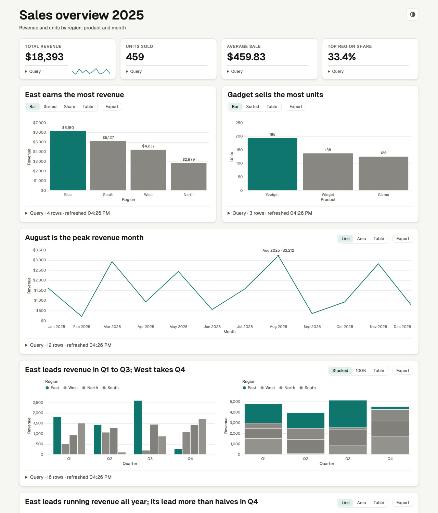

# make-dashboard

**Prompt → SQL + chart kinds → one static HTML dashboard where every chart shows
its SQL and when it was refreshed.** Local, offline, open source, and usable
by any agent that can run shell commands.



- **One spec, `dashboard.json`**: data sources, named SQL queries, KPI tiles and
  charts (kinds or raw Vega-Lite). The agent writes it; scripts do the rest.
- **One output file, `dist/index.html`**: charts, data and libraries are all
  inlined. It opens from disk, needs no server and loads nothing from the
  network. The inlined chart libraries (Vega, Vega-Lite, vega-embed) add about
  820 KB to every page (839,375 bytes measured at vega 6.4.0, vega-lite 6.5.0,
  vega-embed 7.3.0), before fonts and data.
- **Provenance on every card**: expand *Query* to see the SQL, the row count,
  the refresh time and the first rows of the result.
- **Chart kinds, not chart code**: 11 kinds (bar, stacked-bar, grouped-bar, line,
  area, scatter, bubble, heatmap, histogram, boxplot, donut). Name the columns;
  the build adds tooltips, legend filter or zoom, alternate views (sorted,
  share, 100%, area/line, ...), a sortable Table view and PNG, SVG and CSV
  export. Raw Vega-Lite still works for anything else.
- **Themes**: `paper` (default), `blueprint`, `editorial`, `ink`, and the newer
  `dusk`, `press` and `poster`, plus `mono` (terminal console, dark mode near-black
  with a cyan accent) and `brief` (executive, warm white with a burgundy accent); the
  page also toggles Auto, Light and Dark.
- **Live reload**: `serve.mjs --watch dashboard.json` rebuilds when you save the
  spec or the data and reloads the page.
- **Refresh is a rebuild**: rerun `build.mjs` (from cron, launchd or by hand).
  No LLM is involved.
- **Stamped**: a favicon, an icon theme toggle and a provenance footer beside the refresh time (model, effort, agent from `generatedBy` or `--model`/`--effort`/`--agent`; "not reported" when unknown). Put `generatedBy` in `dashboard.json`: `serve.mjs --watch` rebuilds from the spec and takes no such flags. `scripts/doctor.mjs` reports anything missing before the first build.

> Agents: the instructions you follow are in [`SKILL.md`](SKILL.md). This
> README is for people.

## Quick start

Replace `<skill-dir>` with the folder that holds this README. Run each line as one
plain command with that literal path: no shell variable, no `&&` or `;` chains.

```bash
npm ci --omit=dev --prefix <skill-dir>                  # one-time
node <skill-dir>/scripts/doctor.mjs                     # optional: what is missing, and how to fix it
node <skill-dir>/scripts/inspect.mjs data/sales.csv     # columns, types, 5 sample rows, distinct/min/max/nulls
# … write dashboard.json (or let your agent write it) …
node <skill-dir>/scripts/validate.mjs dashboard.json    # prints `valid`, or path-precise errors
node <skill-dir>/scripts/query.mjs dashboard.json --chart c1   # the rows a chart will show
node <skill-dir>/scripts/build.mjs dashboard.json       # writes dist/index.html and prints its file:// URL
node <skill-dir>/scripts/check.mjs dist --shots shots   # optional: open it in a browser, light and dark
node <skill-dir>/scripts/serve.mjs dist --open          # or just open dist/index.html
node <skill-dir>/scripts/serve.mjs --watch dashboard.json --open   # live: rebuilds on save
```

From an agent, just ask: *"Build a dashboard of revenue by region and the
monthly trend from data/sales.csv."* In Claude Code or Copilot you can call
`/make-dashboard …`, and in Codex `$make-dashboard …`.

## The spec

```json
{
  "title": "Sales overview",
  "sources": { "sales": { "type": "csv", "path": "data/sales.csv" } },
  "queries": {
    "total": "SELECT SUM(amount) AS revenue FROM sales",
    "by_region": "SELECT region, SUM(amount) AS revenue FROM sales GROUP BY 1 ORDER BY 2 DESC"
  },
  "kpis": [
    { "id": "k1", "title": "Total revenue", "query": "total", "field": "revenue", "format": "currency" }
  ],
  "charts": [
    { "id": "c1", "title": "North drives half of revenue", "query": "by_region", "width": "half",
      "kind": "bar", "x": "region", "y": "revenue", "format": "currency" }
  ]
}
```

| Field | What it holds |
|---|---|
| `sources` | `csv`, `parquet`, `json` files (each becomes a table named after its key); `duckdb`, `sqlite` database files; `postgres`, `mysql` via `"env": "VAR"` naming an environment variable with the connection string |
| `queries` | One SQL `SELECT` per name. Alias every aggregate; chart fields are those aliases |
| `kpis` | Number tiles: `query`, `field`, `format` = `number`, `currency`, `percent` or `compact` |
| `charts` | Each has exactly one of `kind` (+ role columns `x`, `y`, `color`, `size`, `value`, optional `format`, `views`, `pair`) or raw `vegaLite` (a Vega-Lite spec **without `data`**). `width` = `full` or `half` |
| `theme` | `paper` (default), `blueprint`, `editorial`, `ink`, `dusk`, `press`, `poster`, `mono`, `brief` |
| `maxRows` | Row cap applied to every query (default 5000, max 100000) |

The full reference is in [`references/schema.md`](references/schema.md), every kind
(roles, views, rules) is in [`references/kinds.md`](references/kinds.md), and
there are working specs in [`references/examples/`](references/examples/).

## Scripts

| Command | Does | Flags |
|---|---|---|
| `inspect.mjs <file>` | Column names, types, 5 sample rows and per-column distinct count, min, max and null share of a csv/parquet/json file (or `--spec <spec> --source <name>`, which works on a draft whose queries do not run yet) | `--type`, `--json`, `--allow-outside` |
| `validate.mjs <spec>` | Schema, references, SQL guard; runs every query against the real data and expands every chart, as build does, so slice and colour caps, KPI row counts and value errors show here. `valid` means buildable | `--json`, `--timeout <s>`, `--allow-outside`, `--bind-only` (bind with `LIMIT 0` only: faster, misses value checks) |
| `query.mjs <spec> --chart <id>` | Runs one chart's query as build does and prints its rows, so a title can state what they show | `--limit <n>` (default 20), `--json`, `--allow-outside`, `--timeout <s>` |
| `build.mjs <spec>` | Runs the queries and writes `dist/index.html` (next to the spec). Prints the page's `file://` URL on its own line and the exact `serve:` command | `--out <dir>`, `--timeout <s>` (default 30), `--theme <name>`, `--model <m>`, `--effort <e>`, `--agent <a>`, `--allow-outside`, `--json` |
| `check.mjs <dist>` | Opens the built page at 1280 and 390 px, light and dark; fails on console errors, chart errors, empty panes or horizontal scroll. Without a browser it prints `check: skipped` and exits 0 | `--shots <dir>` (one PNG per width and colour scheme: open them and look), `--json` |
| `doctor.mjs` | What the skill needs and is missing, with the fix for your OS; `--fix <ids>` installs the ones that need no `sudo`. Runs before `npm ci`. Exit `0` when nothing required is missing, `1` when something is, `2` on a usage error | `--json`, `--for <check\|spec.json>`, `--fix <id[,id]>` |
| `serve.mjs [dir]` | Serves the built page on `127.0.0.1`. `--open` warns instead of crashing when no opener exists; `PA_NO_BROWSER=1` never opens one | `--port <n>`, `--open` |
| `serve.mjs --watch <spec>` | Builds, serves and live-reloads; rebuilds on save of the spec or file sources. Has a *Rebuild now* button. Postgres/MySQL need `--interval`. It never exits: run it in the background and stop it when done | `--interval <5..86400 s>`, `--theme <name>`, `--port`, `--open`, `--allow-outside`, `--timeout`, `--out <dir>` |
| `setup.mjs [spec]` | One-time `INSTALL` of the DuckDB extensions for sqlite/postgres/mysql, so builds stay offline | — |

Exit codes for every script: `0` OK, `1` spec errors, `2` usage or IO error. A script
run before `npm ci` prints the doctor command to install the dependencies and exits `2`.
Errors name the JSON path and suggest the fix:

```
charts[0].query: "rev_by_regin" not found; did you mean "rev_by_region"?
charts[0].y: "revnue" is not a column of query "rev_by_region" (columns: region, revenue); did you mean "revenue"?
sources.sales.path: resolves outside the spec folder (/etc/passwd); copy or move the data under /proj and point the path there (--allow-outside is the owner's flag to add, not a fix to apply)
```

## Live reload and scheduled refresh

`serve.mjs --watch` is for editing: it serves a copy of the page whose CSP adds
`connect-src 'self'` for the update stream. The file on disk keeps
`default-src 'none'`, and a page opened from disk (`file://`) is static.
A failed build shows a banner and keeps the last good page.

[`references/refresh.md`](references/refresh.md) also has a crontab line and a
launchd plist that rebuild the page on a schedule. For Postgres or MySQL
sources, the connection-string variable must be set in that environment.

## Security

The agent writes the SQL, so it is treated as untrusted:

- Every query must parse with DuckDB's own parser as a single SELECT, and then
  an **allowlist** runs over its syntax tree. It may read only the declared
  sources (`name`, `source.table`, `source.schema.table`) and CTEs defined in
  the same query. The only table functions allowed are `range`,
  `generate_series` and `unnest`, so `query()`, `read_*`, `glob`, `duckdb_*()`,
  `sqlite_*`/`postgres_*`/`mysql_*` and `pragma_*` are all rejected. System
  catalogs (`pg_catalog`, `information_schema`) and functions that read
  settings or the environment (`current_setting`, `getenv`) are rejected too.
  Scalar and aggregate functions are otherwise open (a denylist), because they
  cannot read files.
- Queries run on a connection locked to the exact declared files
  (`allowed_paths`, external access off, configuration locked). Each one is
  wrapped in a row limit and stopped after a timeout.
- An attached DuckDB file that defines views or macros is refused: they would
  run outside the allowlist. Export plain tables instead.
- Sources must resolve to regular files inside the spec's folder.
  `--allow-outside` is a flag only the person running the command can add.
  The spec can't add it.
- Database sources attach `READ_ONLY`, which limits DuckDB only. For Postgres
  and MySQL, **use a read-only database role**: that is the real guard, because
  statements are passed through to the server. Connection strings are read from
  environment variables and scrubbed from error messages. Result cells are
  scrubbed for them too, but that is defence in depth only: the guard above is
  the control that keeps secrets out of result rows.
- Charts can't load or link to anything: `url`, `data`, `usermeta` and `href` are rejected
  anywhere in `vegaLite`, and a top-level `config`, `width` or `autosize` is rejected
  because the build sets them (kind charts carry no Vega-Lite from you at all).
  Table names in SQL match case-insensitively, as DuckDB binds them; system names are
  refused in any case. The page runs under a CSP without `unsafe-eval`
  (Vega's AST interpreter is used) and with chart actions disabled.
- **The built page contains the query results.** Sharing it shares the data.

## Requirements and licences

Node.js ≥ 20. The dependencies, pinned by the lockfile, are DuckDB (MIT),
Vega, Vega-Lite and vega-embed (BSD-3-Clause), and Ajv (MIT). The page embeds
latin subsets of the chosen theme's fonts, from the bundled Geist, Geist Mono, Newsreader,
Bricolage Grotesque, Atkinson Hyperlegible, Funnel Display, Host Grotesk, Commit Mono,
Young Serif, Schibsted Grotesk, JetBrains Mono, Big Shoulders Display, Familjen Grotesk
and Martian Mono (OFL-1.1, via Fontsource); the licence texts ship in `shared/fonts/LICENSES/`.
